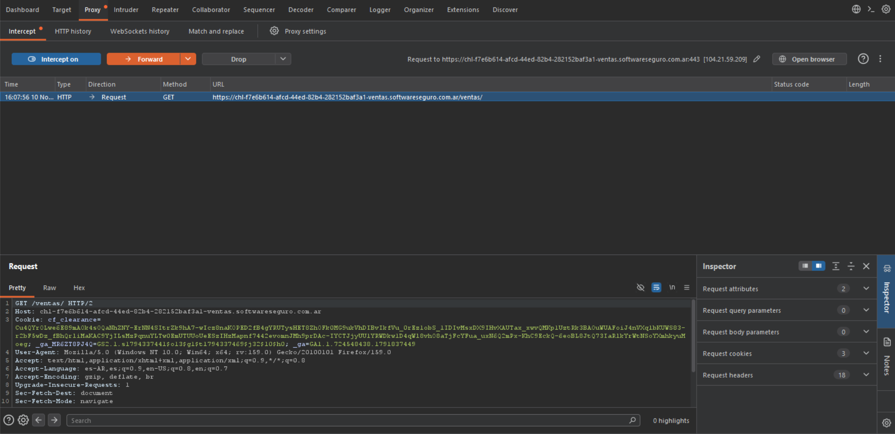

## Configuración de Entorno: Proxy Burp Suite

En la imagen se observa cómo el navegador intenta acceder al laboratorio de "Ventas", pero Burp Suite intercepta la petición GET /ventas/ antes de que llegue al servidor. En el panel principal se visualizan los encabezados HTTP (como el Host, las Cookies de sesión y el User-Agent del navegador) en texto plano. Esto demuestra que el tráfico está siendo ruteado y capturado correctamente para su análisis.

**Proxy**

Un proxy (servidor intermediario) es un software que se interpone entre el navegador y el servidor web. En lugar de que el navegador se comunique directamente con internet, este envía sus peticiones al proxy, y el proxy se encarga de reenviarlas al destino. 

*  **Proxy de interceptación:** no solo reenvían el tráfico, sino que tienen la capacidad de analizarlo detenidamente, pueden detenerlo, mostrarlo en pantalla y permitir su modificación en tiempo real, tanto en el viaje de ida (petición) como en el de vuelta (respuesta). 

**VPN**

Una VPN  (Virtual Private Network) es un túnel cifrado que se establece entre la computadora del usuario y un servidor remoto de la VPN. Su objetivo principal es la privacidad: busca ocultar la dirección IP real del usuario y cifrar todo el tráfico de la máquina, de modo que el proveedor de internet, las redes WiFi públicas o terceros no puedan espiar qué sitios visita o qué datos transmite.

### Diferencias Clave
Aunque ambas tecnologías actúan como intermediarios, tienen propósitos opuestos:
* La VPN se utiliza para la privacidad y la evasión (ocultar la identidad del usuario). El proxy se utiliza para el análisis y la manipulación (ver y modificar lo que viaja).

* En una VPN, el tráfico se encripta y "sale al mundo" desde el servidor de la VPN, ocultando el origen. En un proxy (como Burp), el tráfico no busca ocultarse, sino que se redirige hacia la herramienta de análisis, donde se lo intercepta y examina antes de dejarlo continuar hacia el servidor final.
