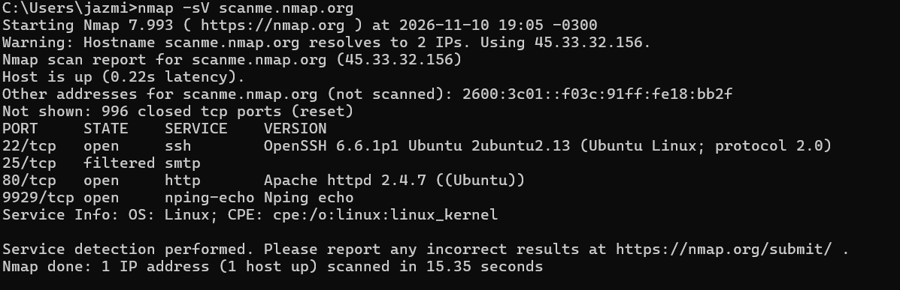

# Objetivo 2: Escaneo de Puertos con Nmap

Para cumplir con los objetivos del laboratorio de forma ética y legal, se utilizó como objetivo el dominio **`scanme.nmap.org`**. Este es un servidor público proporcionado oficialmente por los creadores de Nmap para que estudiantes y profesionales realicen pruebas de escaneo y reconocimiento sin violar ninguna ley.

## ¿Qué es Nmap y cómo se ejecutó?
Nmap (Network Mapper) es una herramienta de escaneo de red de código abierto. Su función es enviar paquetes a un objetivo y analizar las respuestas para determinar qué puertos están abiertos, cerrados o filtrados, y qué servicios (y versiones) se ejecutan en ellos.

El comando ejecutado en la terminal de Windows fue:
    nmap -sV scanme.nmap.org

El parámetro `-sV` (Service Version) le indica a Nmap que no solo busque puertos abiertos, sino que intente identificar el software y la versión exacta que está escuchando en ese puerto.

El escaneo reveló que el servidor (con dirección IP 45.33.32.156) es un sistema operativo **Linux (Ubuntu)**. Se identificaron los siguientes servicios en la superficie de exposición:

*   **Puerto 22 (SSH) - Abierto:** Ejecuta `OpenSSH 6.6.1p1`. Es un servicio de administración remota. Al estar expuesto, podría ser objeto de ataques de fuerza bruta o explotación de vulnerabilidades de esa versión antigua.

*   **Puerto 25 (SMTP) - Filtrado:** Servicio de correo. El estado "filtered" indica que existe un firewall bloqueando el tráfico hacia este puerto, lo cual es una buena práctica de seguridad.

*   **Puerto 80 (HTTP) - Abierto:** Ejecuta `Apache httpd 2.4.7`. Es el servidor web público del sitio.

*   **Puerto 9929 (nping-echo) - Abierto:** Un servicio de prueba utilizado por la comunidad de Nmap.

*(Nota: Nmap escaneó los 1000 puertos más comunes, de los cuales 996 estaban cerrados).*
