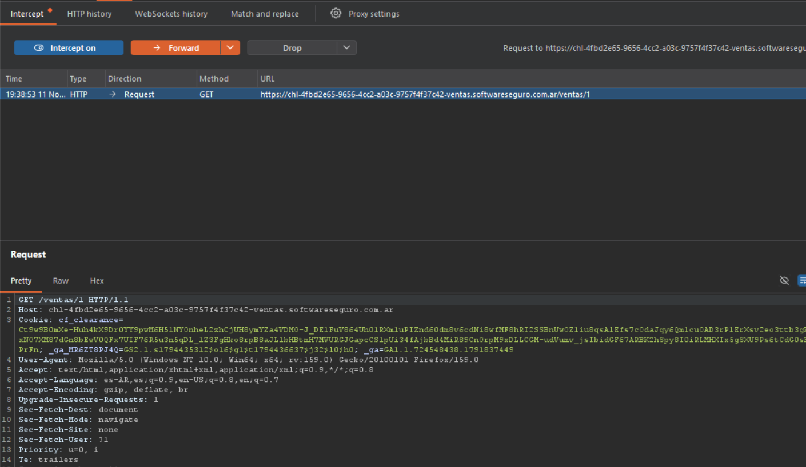

## Objetivo 1: Man-in-the-Middle Local (Configuración y Certificado CA)

Instalad Burp Suite y configurado el proxy de interceptación local (en `127.0.0.1:8080`), se instaló el certificado CA de Burp en el navegador Firefox para permitir la lectura del tráfico HTTPS.

Usé el laboratorio de "Ventas" de la plataforma Software Seguro como objetivo para validar la intercepción. 

A continuación, se documenta el endpoint identificado en el tráfico capturado:

#### Análisis

*   **Endpoint:** `/ventas/1`
    *   **Método HTTP:** `GET`
    *   **Función:** Solicita al servidor la información de las ventas número 1. 
    *   **Análisis de seguridad:** Esta petición fue clave en el laboratorio porque sufre de Information Disclosure. El servidor expone las ventas de forma secuencial. Al no tener un control de acceso adecuado, un atacante puede iterar sobre diferentes IDs (como se demostró anteriormente con el script en Python). El sistema devolvía respuestas 403 Forbidden para los registros existentes pero a los cuales no teniamos autorización para ver y 404 Not Found para los inexistentes, lo que permitió enumerar y contabilizar el total de ventas de la competencia.