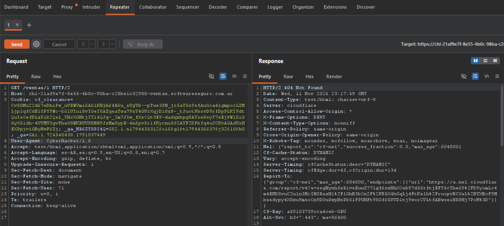

## Objetivo 2: Manipulación Manual de Peticiones (Uso del Repeater)

El Repeater de Burp Suite es una herramienta que permite interceptar una petición HTTP, modificarla manualmente y reenviarla al servidor de forma iterativa. Nos da el control total para analizar cómo responde el servidor ante distintas variaciones en los parámetros, cabeceras o rutas sin la intervención del navegador.

### Modificación de Cabecera(User-Agent)
 Se modificó el encabezado `User-Agent` original (que identificaba al navegador Firefox) por un valor personalizado inventado (`CyberHacker/1.0`). con el objetivo de saber si el servidor web aplica controles de seguridad, filtros o bloqueos basados en la identidad del cliente (User-Agent).

El servidor (protegido por Cloudflare) procesó la petición y respondió con un código **`HTTP/2 404 Not Found`**. Esto indica dos cosas: primero, que el servidor no bloquea peticiones basadas en un User-Agent desconocido y segundo, que el recurso solicitado (la venta con ID 1) no se encontraba disponible en el backend en el momento de la prueba.