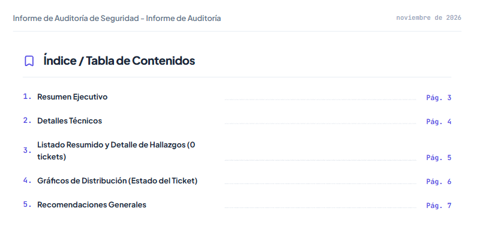

# Objetivo 3: Armado de Plantilla Base de Reporte
Diseña y personaliza tu propia plantilla de reporte profesional. Esta será la herramienta que utilizarás en el resto del curso y en tu vida profesional. La plantilla debe contener obligatoriamente las siguientes secciones: Resumen Ejecutivo (para directivos), Detalles Técnicos, Métricas CVSS, Prueba de Concepto (PoC) detallada paso a paso, y Recomendaciones de Remediación. Explicar la estructura de la plantilla y que valor genera al usuario final que lee un ticket realizado con dicha plantilla

**Herramienta utilizada:** ASVS Tracker - Software Seguro

## Plantilla de Reporte (Estructura)
Utilizando el generador de bloques de la plataforma, construí una plantilla de reporte profesional orientada a ejecutivos y técnicos. La estructura cuenta con las siguientes secciones:

*   **Portada:** Con título del proyecto, versión, fecha, logo y leyenda de confidencialidad.
*   **Resumen Ejecutivo:** Un bloque de texto orientado a la dirección, explicando el impacto en el negocio sin tecnicismos.
*   **Detalles Técnicos:** Breve descripción de las pruebas realizadas (enfoque de caja blanca) y estándares utilizados.
*   **Hallazgos (Tickets):** Bloque que inyecta automáticamente los tickets con sus métricas CVSS y PoCs.
*   **Gráficos:** Representación visual de la cantidad de hallazgos según su criticidad.
*   **Recomendaciones Generales:** Plan de acción general y hoja de ruta de remediación.

Armar esta plantilla me hizo dar cuenta de que el reporte es muy importante, ya que genera un valor distinto según quién lo lea:

*   **Para los Pentesters:** Nos salva de olvidarnos de documentar cosas clave. Tener los campos fijos (como el CVSS o la PoC) hace que podamos trabajar más rápido y mantener un estándar de calidad.

*   **Para los Directivos:** El *Resumen Ejecutivo* les da una traducción del riesgo. No entienden de código, pero sí entienden que un "CVSS 8.1" significa un riesgo alto para la empresa. Esto les permite decidir dónde poner la plata o si tienen que frenar el lanzamiento de un sistema.

*   **Para los Desarrolladores:** Les facilita muchísimo el trabajo. Cuando les llega un ticket con el *Paso a Paso* (PoC) claro, no pierden tiempo intentando adivinar cómo se produjo el error (evitando el clásico "en mi máquina funciona"). Además, el campo de *Recomendaciones* les indica la forma correcta de parchear, para que no apliquen un parche rápido que termine rompiendo otra cosa.