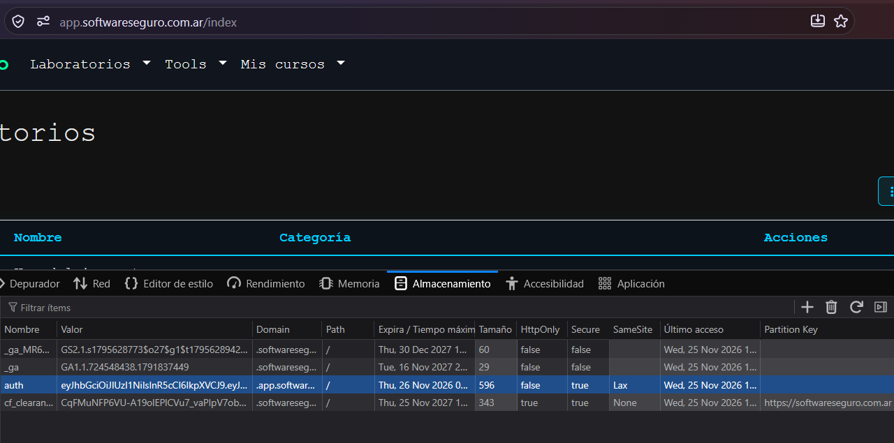
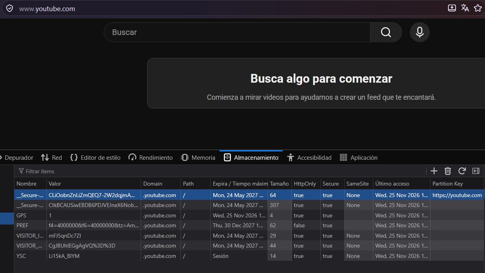
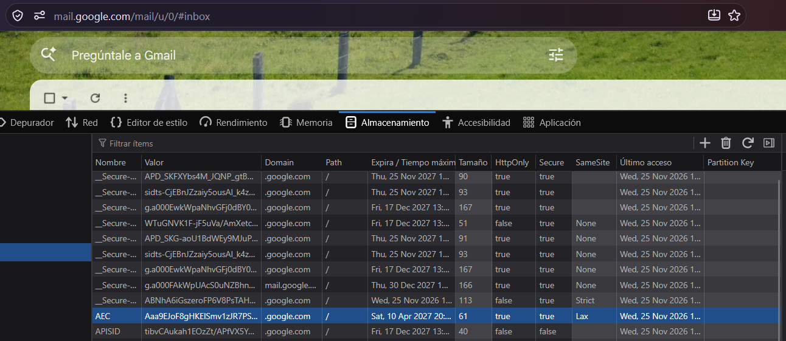

## Objetivo 1: Auditoría de Cookies y Banderas de Seguridad
Utilizando el inspector de tu navegador, analiza las cookies de sesión de tres sitios web de uso público. Tu misión es identificar si implementan correctamente las banderas de seguridad. Explica brevemente qué protege exactamente la bandera HttpOnly y qué riesgo corre el usuario si la cookie de sesión no tiene la bandera Secure activada.

Se analizaron de forma pasiva las cookies de sesión de tres sitios web de uso público utilizando las herramientas de desarrollo del navegador (F12 > Almacenamiento > Cookies).

| Sitio Web | Cookie Analizada | Secure | HttpOnly | SameSite |
| :--- | :--- | :--- | :--- | :--- |
| Software Seguro | `auth` | true | false | Lax |
| YouTube | `__Secure-...` | true | true | None |
| Gmail (Google) | `AEC` | true | true | Lax |

**Evidencia:**

* Software Seguro

* YouTube

* Gmail

---

#### ¿Qué protege la bandera HttpOnly?

La bandera `HttpOnly` le indica al navegador que la cookie **no debe ser accesible a través de JavaScript** (por ejemplo, mediante `document.cookie`). Su función principal es mitigar los ataques de **Cross-Site Scripting (XSS)**. Si un atacante logra inyectar un script malicioso en la página, el navegador bloqueará cualquier intento de leer la cookie de sesión, evitando así que el atacante pueda robar el token y realizar un secuestro de sesión.

#### ¿Qué riesgo corre el usuario si falta la bandera Secure?

La bandera `Secure` instruye al navegador a enviar la cookie **únicamente a través de conexiones cifradas (HTTPS)**. Si esta bandera no está activada (o está en `false`), la cookie viaja en texto plano por la red. Un atacante que se encuentre en la misma red (por ejemplo, un ataque Man-in-the-Middle en un WiFi público) podría interceptar el tráfico HTTP, capturar la cookie de sesión y utilizarla para autenticarse como el usuario legítimo, accediendo a su cuenta sin necesidad de conocer la contraseña.g