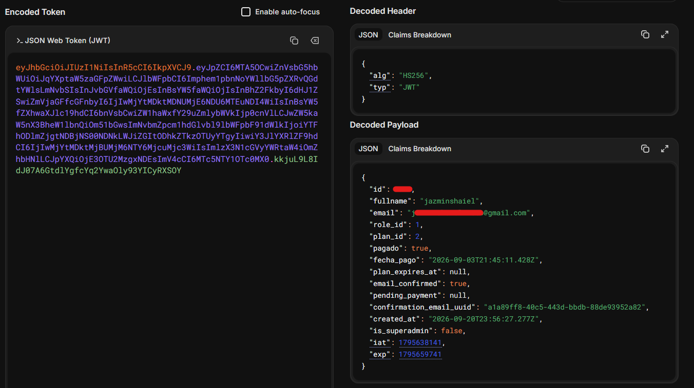

## Objetivo 2: Ingeniería Inversa a JSON Web Tokens (JWT)

Intercepta un JWT válido de una aplicación web (puedes usar un sitio de pruebas o extraer uno de tus propias sesiones diarias). Decodifica su contenido (puedes usar herramientas públicas como jwt.io de forma segura, o la terminal). Identifica la estructura técnica: ¿Qué algoritmo de firma se está utilizando en el Header? ¿Qué datos sensibles o roles se están enviando en el Payload en texto plano?

Se interceptó de forma pasiva el token JWT almacenado en la cookie `auth` al navegar por la plataforma de Software Seguro. Al decodificarlo con la herramienta **jwt.io**, se identificó su estructura estándar de tres partes.

### Header (Encabezado)
```json
{
  "alg": "HS256",
  "typ": "JWT"
}
```

Algoritmo de firma: El token utiliza HS256 (HMAC SHA-256). Es un algoritmo simétrico (se usa la misma clave secreta para firmar y validar), lo cual es el estándar para este tipo de aplicaciones.

### Payload (Cuerpo)
```json
{
  "id": 1098,
  "fullname": "jazminshaiel",
  "email": "[oculto por privacidad]",
  "role_id": 1,
  "plan_id": 2,
  "pagado": true,
  "fecha_pago": "2026-09-03T21:45:11.428Z",
  "plan_expires_at": null,
  "email_confirmed": true,
  "pending_payment": null,
  "confirmation_email_uuid": "a1a89ff8-40c5-443d-bbdb-88de93952a82",
  "created_at": "2026-09-20T23:56:27.277Z",
  "is_superadmin": false,
  "iat": 1795638141,
  "exp": 1795659741
}
```

El Payload viaja codificado en Base64 (no encriptado), por lo que cualquiera puede leerlo. Se observa información crítica como por ejemplo...

* **Roles y privilegios:** role_id: 1, is_superadmin: false. Un atacante intentaría modificar el is_superadmin a true para escalar privilegios.

* **Datos personales:** Nombre, email y fecha de creación de la cuenta.

* **Datos de negocio:** plan_id: 2, pagado: true y fecha_pago.

* **Vigencia:** El token expira el iat: 1795659741 (que corresponde al año 2026).



La ingeniería inversa del JWT demuestra que el payload es legible por cualquier persona que tenga acceso al token. Por lo tanto, incluir información sensible en el token no es una buena práctica, ya que Base64 no es un cifrado.